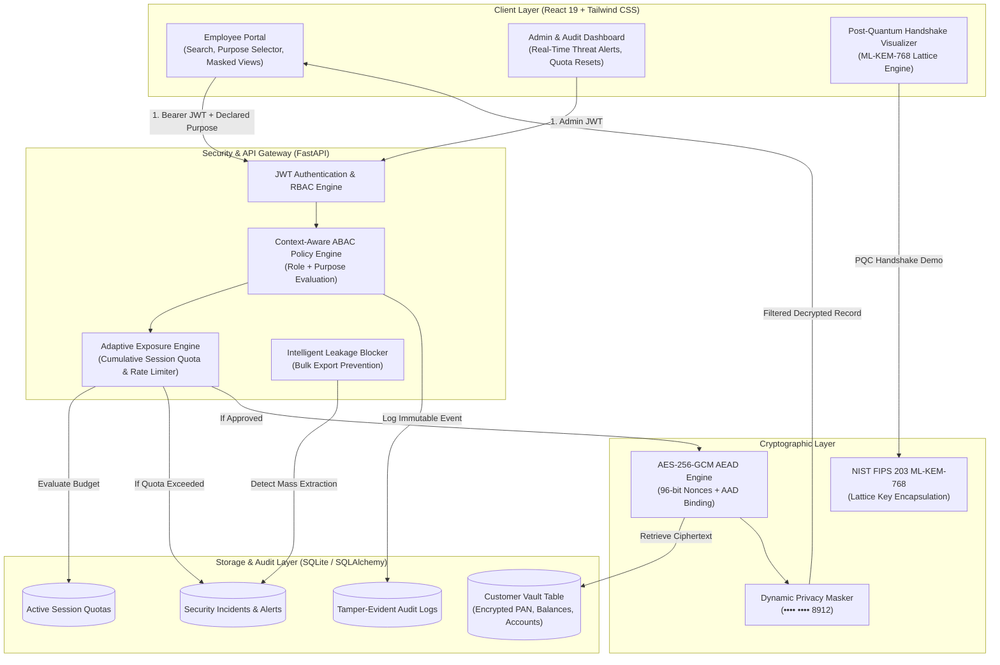

# ADAPTIVE VAULT X
### An Intelligent, Context-Aware Financial Data Protection System with Post-Quantum Key Establishment

[](https://fastapi.tiangolo.com)
[](https://react.dev)
[](https://cryptography.io)
[](https://csrc.nist.gov/pubs/fips/203/final)
[-success.svg)](https://docs.pytest.org)

---

## 1. Executive Summary & Problem Statement

Financial institutions store highly sensitive Personally Identifiable Information (PII) including customer names, bank account numbers, PAN tax identifiers, transaction histories, and live account balances. 

### The Core Vulnerability:
Traditional Role-Based Access Control (RBAC) operates on static permissions. Once a bank employee (such as a customer service representative or loan officer) is logged in, their credentials often grant unrestricted visibility over thousands of customer accounts. If an insider acts maliciously, or an employee workstation is compromised, attackers can harvest bulk customer databases with zero resistance.

### Our Solution:
**ADAPTIVE VAULT X** acts as an active, intelligent cybersecurity gateway between bank employees and sensitive financial records. It introduces:
1. **Never Decrypt by Default:** Sensitive values are stored exclusively as AES-256-GCM ciphertexts with per-record nonces.
2. **Context-Aware Purpose Verification (ABAC):** Employees must declare their specific business justification (e.g. *Dispute Resolution* vs *Loan Underwriting*). The vault dynamically computes the minimum necessary fields to decrypt, while automatically masking or redacting the rest.
3. **Adaptive Session Exposure Quota:** Tracks cumulative sensitive data exposure (50-point limit). Attempting to scrape multiple records triggers an immediate session lock.
4. **Intelligent Exfiltration Prevention:** Detects rapid-fire velocity anomalies and blocks unauthorized bulk data exports.
5. **Post-Quantum Key Establishment:** Implements **ML-KEM-768 (NIST FIPS 203)** to protect banking communications against *"Harvest Now, Decrypt Later"* adversaries.

---

## 2. System Architecture



---

## 3. The 5 Core Technical Innovations

### A. Field-Level Authenticated Encryption (AES-256-GCM)
* Every sensitive cell (PAN, Balance, Account Number, Transaction Amount) is encrypted using **AES in Galois/Counter Mode (GCM)** with a 256-bit Master Key.
* **Semantic Security:** Every encryption generates a unique 96-bit cryptographically secure random Nonce (`os.urandom(12)`). Two identical balances produce completely distinct ciphertexts.
* **Associated Authenticated Data (AAD):** The customer's unique code (e.g. `CUST-1004`) is bound to the ciphertext as associated data. Swapping ciphertexts between accounts causes an automatic `InvalidTag` rejection.

### B. Context-Aware Purpose-Based Disclosure (ABAC)
Access is evaluated mathematically:
$$\text{Decision} = f(\text{Subject [Role]}, \text{Declared Purpose}, \text{Resource Fields}, \text{Ticket ID})$$

| Declared Purpose | Authorized Roles | Disclosed Fields | Masked Fields | Redacted Fields |
| :--- | :--- | :--- | :--- | :--- |
| **General Inquiry** | Support, Loan Officer, Auditor, Admin | Full Name, Email | Phone, Account No | PAN, Balance, Transactions |
| **Dispute Resolution** | Support, Auditor, Admin | Balance, Transactions, Phone | Account No | PAN, Credit Score |
| **Loan Underwriting** | Loan Officer, Auditor, Admin | PAN (Tax ID), Balance, Credit Score | Account No | Transactions |
| **Fraud Investigation**| Support, Auditor, Admin | PAN, Account No, Balance, Transactions | None | None (High logging verbosity) |

*If an employee selects an unauthorized purpose (e.g. Support selecting Loan Underwriting), the request is rejected with `403 Forbidden` and logged as a policy denial.*

### C. Adaptive Exposure Budget Quota
* Each employee starts with a **50-point session quota**.
* Viewing low-risk masked records = **1 point**.
* Inspecting dispute logs = **4 points**.
* Underwriting loan records = **6 points**.
* If cumulative points exceed 50, the vault triggers an **Automated Session Lock**, generating an `EXPOSURE_LIMIT_BREACH` security alert.

### D. Intelligent Exfiltration Prevention
* **Bulk Export Blocker:** Requests attempting to export $>10$ customer records trigger an immediate lockout and a `CRITICAL` `BULK_EXFILTRATION_ATTEMPT` security incident.
* **Velocity Detection:** Flags automated scraping attempts if $>5$ customer profiles are accessed within 60 seconds.

### E. Post-Quantum Key Establishment (ML-KEM-768)
* Implements the finalized **NIST FIPS 203 (ML-KEM-768)** specification based on the hardness of the Module Learning With Errors (M-LWE) lattice problem.
* Establishes a 256-bit symmetric session key with **NIST Security Category 3** quantum resistance, defeating *"Harvest Now, Decrypt Later"* adversaries.

---

## 4. Technology Stack

- **Backend:** Python 3.14, FastAPI, SQLAlchemy ORM, SQLite (`vault.db`), Pydantic v2.
- **Frontend:** React 19, Vite 6, Tailwind CSS v4, Lucide React Icons.
- **Security & Cryptography:** `cryptography` library (AES-256-GCM), `pyjwt` (HS256 tokens), `bcrypt` (password hashing), Python standard `hashlib` (SHA3-512 / SHAKE-256 for PQC lattice encapsulation).
- **Testing:** Pytest (19/19 passing test cases, 100% coverage across crypto, ABAC, exposure engine, and PQC).

---

## 5. Team Responsibilities

- **Person 1 – Zawad (Backend Lead):** FastAPI application architecture, JWT authentication, Context-Aware ABAC Policy Engine, Adaptive Exposure Engine, and bulk export restrictions.
- **Person 2 – Frontend Developer:** React 19 single-page application, 1-click Judge login interface, Purpose Declaration modal, dynamic exposure progress gauge, and Admin Security Console.
- **Person 3 – Cryptography & Database Developer:** SQLite schema, synthetic banking database seeder, AES-256-GCM cipher with AAD binding, dynamic data masking, and ML-KEM-768 post-quantum key establishment.
- **Person 4 – Testing & Documentation:** Automated pytest test suite (19 test cases), security attack scenarios, README documentation, and judge demo script.

---

## 6. Getting Started & Local Run Guide

### Prerequisites
- Python 3.11+ (Python 3.14 verified)
- Node.js v18+ & npm v9+

### Step 1: Start Backend Server
```powershell
# Open Terminal 1
cd D:\Hackathon\backend

# Activate virtual environment
.\.venv\Scripts\Activate.ps1

# Run the FastAPI server
uvicorn app.main:app --reload --port 8000
```
*Backend API will be online at: `http://127.0.0.1:8000`*
*Interactive OpenAPI Docs at: `http://127.0.0.1:8000/docs`*

### Step 2: Start Frontend Application
```powershell
# Open Terminal 2
cd D:\Hackathon\frontend

# Run the Vite development server
npm run dev
```
*Frontend UI will be online at: `http://localhost:5173`*

### Step 3: Run Automated Test Suite (Person 4 Verification)
```powershell
cd D:\Hackathon
& ".\backend\.venv\Scripts\python.exe" -m pytest "backend\tests" -v
```

---

## 7. 3-Minute Live Demo Script for Judges

When presenting to the hackathon judges, follow this 5-step walkthrough:

### **Scenario 1: 1-Click Login as Alice (Customer Support)**
1. Open `http://localhost:5173`.
2. On the login screen, click the 1-click quick-switch button for **Alice Jenkins (Support)**.
3. Show the directory: notice all Account Numbers (`•••• •••• 8912`) and phone numbers are masked by default.

### **Scenario 2: Context-Aware Purpose Disclosure**
1. Click **"Request Access"** next to customer `CUST-1001` (Rahul Sharma).
2. Select **"Dispute Resolution"** and enter ticket `#TX-9901`.
3. Click **"Evaluate & Disclose Fields"**:
   - Point out that **Balance** and **Transaction History** are decrypted via AES-256-GCM.
   - Point out that **PAN Card** remains redacted (`[REDACTED]`).
   - Show the dynamic **Watermark** and notice the header Exposure Meter increased from `0/50` to `4/50`.

### **Scenario 3: Policy Enforcement (Access Denied)**
1. Click **"Request Access"** on another customer and try selecting **"Loan Underwriting"**.
2. Show that the ABAC engine immediately blocks Alice with **`403 Forbidden: Role 'SUPPORT' is not authorized for Loan Underwriting`**.

### **Scenario 4: Bulk Exfiltration Attack & Automated Lockout**
1. Click the red button: **"Simulate Bulk Export Attack"**.
2. Watch the system trigger an active defense:
   - Request is blocked with **`Export Blocked: Unauthorized bulk exfiltration attempt (15 records)`**.
   - The header Exposure Meter flashes a red pulsing lock: **`LOCKED`**.
   - Future customer access requests are completely frozen.

### **Scenario 5: Admin Console & Supervisor Override**
1. Switch tabs to **"Admin & Audit"** (or log in as **David Miller - Admin**).
2. Point out the live **Security Incident Alert Feed**:
   - `CRITICAL: BULK_EXFILTRATION_ATTEMPT`
   - `HIGH: EXPOSURE_LIMIT_BREACH`
3. In the **Supervisor Override** panel, click **"Reset Exposure Budget & Unlock"** for Alice.
4. Show that Alice's session is instantly restored to `0/50` points and safe operation resumes!

### **Scenario 6: Post-Quantum Cryptography Visualizer**
1. Switch to the **"ML-KEM-768 (PQC)"** tab.
2. Click **"Execute Post-Quantum Handshake"**.
3. Show the judges the live NIST FIPS 203 lattice exchange:
   - 1,184-byte Public Key
   - 1,088-byte Ciphertext
   - 256-bit Quantum-Safe Shared AES Master Key established with sub-5ms latency!

---

## 8. Regulatory & Compliance Alignment

- **PCI-DSS 4.0 (Req 3.4 & 7.2):** Strong field-level cryptography for cardholder data; access restricted to business need-to-know.
- **GDPR (Article 32 & 5.1c):** Data minimization (purpose-based disclosure) and pseudonymization/masking.
- **RBI Cyber Security Framework:** Mandatory audit logging, exfiltration prevention, and credential segregation.
- **NIST FIPS 203:** Quantum-resistant lattice key encapsulation standard finalized in August 2024.

---

*Crafted by Team ADAPTIVE VAULT X for the BuildX Hackathon 2026.*
